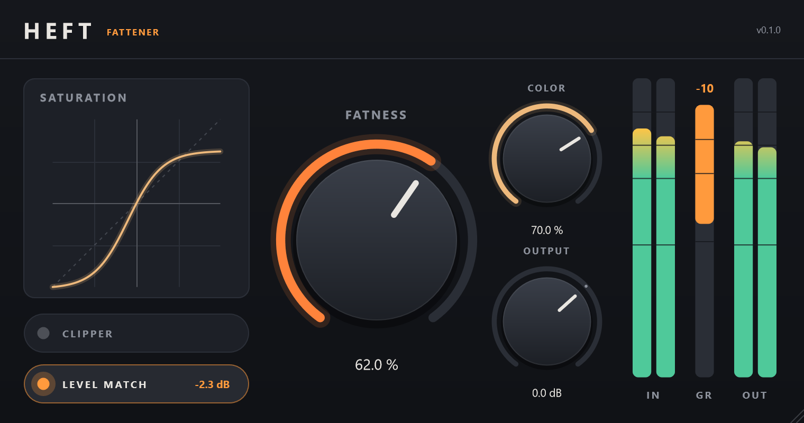

# Heft

[](https://github.com/Remaori/Heft/actions/workflows/build.yml)
[](https://github.com/Remaori/Heft/releases/latest)
[](LICENSE)


[](https://juce.com)

[](https://github.com/Tracktion/pluginval)

VST3 plugin (Windows, 64-bit, stereo) that makes a sound feel thicker, denser
and louder with just a few controls. Built with JUCE 9.0.4 + CMake.

<p align="center"></p>

| Control | What it does |
|---|---|
| **Fatness** (0–100 %) | Raises compression and saturation together. Transparent at 0 %. |
| **Color** (0–100 %) | Saturation character: 0 % dark/warm, 100 % bright/aggressive (more even harmonics). |
| **Output** (−24…+12 dB) | Final level. |
| **Clipper** | Soft clipper at the very end: linear up to −2.5 dBFS, never exceeds 0 dBFS. |
| **Level Match** | Compensates the gain so the processed sound is as loud as the input (honest A/B). |

Signal chain: linked peak compressor → pre-emphasis tilt EQ → asymmetric tanh
saturation (4x oversampled) → de-emphasis → DC blocker → output gain, level match
and soft clipper.

### Interface

- **Meters**: input and output peak levels (IN / OUT) and the compressor's gain
  reduction (GR) with a numeric readout.
- **Saturation curve**: the transfer curve of the saturator for the current Fatness
  and Color. It shows the shape only (scaled to fit), so you can see how hard it bends
  and how asymmetric it is.
- **Level Match readout**: with Level Match on, the switch shows the correction being applied.
- **Knobs**: double-click (or Alt+click) to reset, click the value to type an exact number.
  Hover any control for a tooltip.
- **Resizable**: drag the bottom-right corner (75 %–200 %). The size is saved with the project.

## Download

Get the latest version from [**Releases**](https://github.com/Remaori/Heft/releases/latest):
download `Heft-vX.Y.Z-Windows-x64.zip`, unzip it and copy the `Heft.vst3` folder into
your VST3 folder (see [Add the folder to REAPER](#add-the-folder-to-reaper-once)).

Development builds of every push to `main` are available from the
[Build workflow](https://github.com/Remaori/Heft/actions/workflows/build.yml): open the
most recent green run and download **Heft-VST3-Windows-x64** (you need to be signed in
to GitHub; these builds expire after 90 days).

## Build from source

Requirements: Windows 10/11 x64, [Git](https://git-scm.com), and Visual Studio 2019
or later (or the free *Build Tools for Visual Studio*) with the **Desktop development
with C++** workload, which includes CMake. JUCE is downloaded automatically.

```powershell
git clone https://github.com/Remaori/Heft.git
cd Heft
.\build.bat
```

### Build, validate and install

Double-click **`build.bat`**. It does everything: builds in Release, validates
with pluginval (strictness 10) and installs to `%USERPROFILE%\VST3\Heft.vst3`.
If pluginval fails, it does **not** install.

From a terminal, with options:

```powershell
powershell -ExecutionPolicy Bypass -File build.ps1                 # everything (same as build.bat)
powershell -ExecutionPolicy Bypass -File build.ps1 -Strictness 5   # faster validation
powershell -ExecutionPolicy Bypass -File build.ps1 -Measure        # also measure the sound
powershell -ExecutionPolicy Bypass -File build.ps1 -SkipValidation # build and install only
powershell -ExecutionPolicy Bypass -File build.ps1 -Clean          # from scratch (re-downloads JUCE)
```

If REAPER is open with the plugin loaded, the script stops and tells you
(Windows won't let you replace a DLL that is in use).

### Publishing a new version

1. Bump the version in `CMakeLists.txt` (`project(Heft VERSION 0.2.0 ...)`) and commit it.
2. Tag the commit and push both:

   ```powershell
   git tag v0.2.0
   git push origin main v0.2.0
   ```

GitHub Actions builds and validates the plugin and publishes a release with the
zipped `Heft.vst3`. If the tag doesn't match the version in `CMakeLists.txt`, the
release step fails and nothing is published.

## Add the folder to REAPER (once)

1. REAPER → **Options → Preferences** (Ctrl+P) → **Plug-ins → VST**.
2. Under **VST plug-in paths**, click **Edit path list… → Add path…** and pick
   your `%USERPROFILE%\VST3` folder, e.g. `C:\Users\<you>\VST3`. (You can also type
   `;C:\Users\<you>\VST3` at the end of the field.)
3. Click **Re-scan** (or *Clear cache/re-scan*).
4. It shows up in the FX browser as **VST3: Heft (Ran)**.

After rebuilding, just close and reopen REAPER. If you changed parameters
(names, ranges), also do a **Re-scan**.

## Testing without risking your projects

- Work in a **new test project** with copies of your audio (kick, bass, vocals, drum bus).
- **Turn your monitoring down** the first time: with high Fatness, quiet
  material can come up by about +10 dB. The clipper is off by default.
- In the FX browser, right-click Heft → **Run as → Dedicated process**:
  if the plugin crashes, REAPER doesn't go down with it.
- **Honest A/B**: turn on *Level Match*, leave *Output* at 0 dB and toggle the
  FX bypass. After a big change, wait ~1 s (the level matcher uses a 0.4 s window).
- Before using it in a real project, do **File → Save project as…** (a copy).
- If a project ever fails to open because of the plugin: **File → Open project**
  and tick **Open with FX offline (recovery mode)**.
- Don't change the parameter IDs, ranges or meaning in `Source/Parameters.h`
  once you use the plugin in projects: REAPER stores values with them.

## Where everything is

```
CMakeLists.txt            Project: JUCE version (GIT_TAG 9.0.4), plugin name and codes
build.ps1 / build.bat     Build + validate + install
Source/
  Tuning.h                ★ EVERY number that defines the sound
  Parameters.h            Parameters: names, ranges and defaults
  PluginProcessor.cpp     The chain: prepareToPlay, processChunk (3 phases) and
                          updateCoefficients (how Fatness/Color drive each stage)
  PluginEditor.cpp        UI layout, meter ballistics and tooltips
  UI/Palette.h            Colours and fonts of the whole UI
  UI/HeftLookAndFeel.h    How knobs, switches and text boxes are drawn
  UI/Meters.h             IN / OUT level meters and the GR meter
  UI/CurveDisplay.h       Saturation curve display
  DSP/Compressor.h        1. Linked compressor, peak detector, soft knee, makeup
  DSP/TiltFilter.h        2 and 5. Pre-emphasis tilt EQ and its exact inverse
  DSP/Saturator.h         3. Asymmetric tanh (even harmonics)
                          4. The 4x oversampling is juce::dsp::Oversampling (in PluginProcessor)
  DSP/DcBlocker.h         6. 5 Hz DC-blocking filter
  DSP/LevelMatcher.h      7. Level matcher (RMS)
  DSP/SoftClipper.h       7. Soft clipper
tests/Measure.cpp         HeftMeasure: loads the VST3 and measures it (build.ps1 -Measure)
.github/workflows/        GitHub Actions: build + pluginval + HeftMeasure; releases on v* tags
docs/screenshot.png       UI screenshot used in this README
LICENSE                   GNU AGPL v3
```

## Which numbers to change (all in `Source/Tuning.h`)

| You want… | Change | Current value → try |
|---|---|---|
| Fatness at max to compress more / less | `compThresholdAtMaxDb`, `compRatioAtMax` | −30 dB, 6:1 → −20 dB, 4:1 (gentler) |
| More punch on transients | `compAttackMs` | 2 → 5–10 ms (lets the attack through) |
| More density / "pumping" | `compReleaseMs` | 80 → 40 ms (denser) or 150 ms (smoother) |
| The compressor to add more or less level | `compMakeupAmount` | 0.5 → 0.3 (less) / 0.7 (more) |
| More or less saturation at Fatness 100 % | `driveAtMax` | 4 → 2 (soft) / 8 (very aggressive) |
| Color to change the character more | `tiltMaxDb` | 6 → 9 dB (more pronounced extremes) |
| Move the tilt "center" | `tiltPivotHz` | 700 → 400 (more body) / 1500 (more presence) |
| Even harmonics (tube warmth) | `biasAtMinColor`, `biasAtMaxColor` | 0 / 0.35 → e.g. 0.1 / 0.5 |
| How much "louder" it sounds as Fatness goes up | `fatnessMakeupAtMaxDb` | 6 → 3 (more honest) / 9 |
| Where the clipper starts clipping | `clipperKnee` | 0.75 (−2.5 dBFS) → 0.9 (harder and later) |
| Level matcher speed | `levelMatchWindowSec` | 0.4 → 1.0 s (steadier, slower) |
| Oversampling factor | `oversamplingFactorLog2` | 2 (4x) → 3 (8x: less aliasing, more CPU and latency) |

After each change: `build.bat` (or `build.ps1 -Measure` to see the
measurements) and reopen REAPER.

## Reference measurements (HeftMeasure, 48 kHz)

- Latency: **61 samples** (1.27 ms at 48 kHz), reported to the host and verified with an impulse.
- Fatness 0 %: level change ≤ 0.01 dB, THD+N < −127 dB; flat up to 21 kHz (−0.18 dB at 22 kHz).
- 1 kHz sine at −6 dBFS, Fatness 50 %: THD+N ≈ −24 dB (Color 0 %) to −20 dB (Color 100 %);
  H2 goes from absent (Color 0 %) to −21 dB (Color 100 %).
- Kick-like hits at −6 dBFS: RMS +2.8 / +3.4 / +2.9 / +2.1 dB at Fatness 25 / 50 / 75 / 100 %,
  with the peaks rising less (more density).
- Level Match: 0.00 dB residual difference in the measured cases.
- Clipper: the output peak never exceeds 0 dBFS.

## Known limitations

- **Limited real-world testing**: it is validated automatically with pluginval
  (strictness 10) and with HeftMeasure, which loads it like a host, but it has only
  been tried briefly in REAPER and not in other DAWs.
- **The sound is not tuned by ear yet**: the values were set with synthetic signals
  (sines, a synthetic kick). What sounds "right" is up to you, in `Tuning.h`.
- **The clipper is not oversampled** (it runs last, at the base rate): heavy
  clipping produces some aliasing. The main saturation does have 4x oversampling.
- **The compressor is not oversampled either**, and with a 2 ms attack it distorts
  the lows a bit (part of the "fat" character, but it is not a clean compressor).
- **The level matcher measures RMS, not perceived loudness (LUFS)**: it follows the
  music with ~0.4 s of delay, can "breathe" on very dynamic material, stops updating
  below −60 dBFS and corrects at most ±24 dB. It measures before *Output*, so the
  A/B is only exact with *Output* at 0 dB.
- With high Fatness, quiet material comes up a lot (+9.8 dB measured at Fatness 60 %
  on a sine at −20 dBFS). It's part of the effect, but watch your levels.
- At Color 0 % the saturation is symmetric (no even harmonics); the asymmetry
  grows with Color, by design. If you want even harmonics on the "dark" side too, raise `biasAtMinColor`.
- Fixed latency of 61 samples (shorter in ms at 96 kHz). REAPER compensates for it,
  but you'll notice it a little when monitoring live through the plugin.
- Stereo in and out only. No dry/wet mix, no M/S mode, no presets and no parameter undo.
- The GR meter shows the compressor only; the saturation also lowers peaks, which the
  meter doesn't count.
- The VST3's own bypass keeps the latency, but toggling it can click (no crossfade).
- CPU usage inside REAPER has not been measured (tanh is computed 4 times per sample and channel).
- Windows x64 only; not code-signed.

## License

Copyright (C) 2026 Remaori.

Heft is free software: you can redistribute it and/or modify it under the terms of
the GNU Affero General Public License, version 3. See [LICENSE](LICENSE).

It is built with [JUCE](https://juce.com), which is used under its AGPLv3 license.
VST is a registered trademark of Steinberg Media Technologies GmbH.
